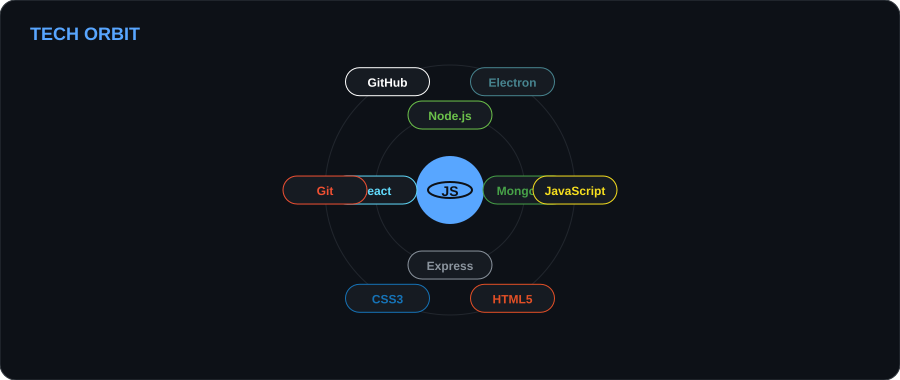
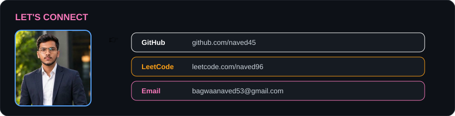

<!-- STEP 1: after uploading your 2-sec video (drag it into this README in GitHub's editor), paste its URL on its own line here -->

## Projects

| Project | Stack | Notes |
|---|---|---|
| Dental Management System | HTML, CSS, JS, Node, Express, MongoDB | Patient and appointment management |
| Event Management Website | MERN | Login, then event-type questionnaire |
| Desktop Companion | Electron | Animated mascot, reminders, AI chat |

